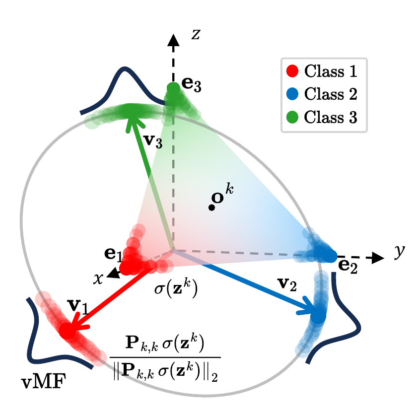

# Hyperspherical Simplex Representations for Backward-Compatible Retrieval

[](https://arxiv.org/abs/2610.29550)
[](https://miccunifi.github.io/PSP/)
[](#code)

This is the **official repository** of the paper
"*Hyperspherical Simplex Representations for Backward-Compatible Retrieval*"
by Simone Ricci\*, Niccolò Biondi\*, Federico Pernici and Alberto Del Bimbo (\*equal contribution).

## Overview

### Abstract
Training modern AI models has become increasingly expensive, and updating deployed models can alter their internal feature representations, affecting applications built upon them. In retrieval systems, such updates often require a complete gallery re-indexing, which is computationally expensive at scale. Existing backward-compatibility methods enable direct comparison between representations produced by updated and earlier models, avoiding re-indexing. However, they typically require compatibility-specific training, learned mapping functions, or modifications to the model architecture, and often depend explicitly on the previous model. In this paper, we propose hyperspherical simplex representations derived from softmax outputs and logits for backward-compatible retrieval across independently trained models. These representations leverage the simplex structure induced by softmax cross-entropy training with one-hot labels, which provides a common geometric reference across model updates. Since this reference depends on the number of classes, introducing new ones during an update expands the simplex, thereby misaligning the prototypes of existing classes with their earlier counterparts. We therefore derive a deterministic linear transformation to restore their alignment. We further provide a theoretical analysis of the formal backward-compatibility definition, identifying two geometric conditions under which its inequalities hold in expectation, assuming von Mises–Fisher class distributions whose concentration increases across updates. Aligned regular-simplex representations satisfy these conditions, providing a theoretical basis for the proposed representations under the stated assumptions. Without using additional compatibility-specific losses, learned mappings, or modifications to the model architecture, the proposed representations achieve competitive results on standard compatibility benchmarks, including scenarios with expanded class sets, more expressive architectures, and independently trained models from public repositories.

<p align="center"></p>

Softmax outputs lie on the probability simplex $`\Delta^{C-1}`$ and are driven to its vertices $`\mathbf e_c`$, which depend only on the label space. The projection $`\mathbf P_{k,k}`$ maps them onto a regular simplex centered at the origin, whose vertices $`\mathbf v_c=\mathbf e_c-\mathbf o`$ are the class prototypes; after $`\ell_2`$-normalization each class is modeled by a von Mises–Fisher distribution around its prototype.

### Method in a Nutshell

1. **PSP** (Probability Simplex Projection): center the softmax outputs and project them onto the hypersphere, with $`\mathbf P_{k,k}=\mathbf I-\tfrac{1}{C^k}\mathbf J`$.
   **LSP** (Logits Simplex Projection): $`\ell_2`$-normalize the logits, which align with the same prototype directions.

```math
\textbf{PSP:}\quad \mathbf h^k=\frac{\mathbf P_{k,k}\,\sigma(\mathbf z^k)}{\lVert\mathbf P_{k,k}\,\sigma(\mathbf z^k)\rVert_2}
\qquad\qquad
\textbf{LSP:}\quad \mathbf h^k=\frac{\mathbf z^k}{\lVert\mathbf z^k\rVert_2}
```

2. **Angular correction**: when an update adds classes ($`C^t>C^k`$), the simplex expands and every existing prototype rotates by

```math
\theta^{k\to t}_c=\arccos\!\left(\sqrt{\frac{C^k-1}{C^k}\cdot\frac{C^t}{C^t-1}}\right).
```

   The deterministic map $`\mathbf P_{t,k}=[\,\mathbf P_{k,k}\mid\mathbf 0\,]`$, applied to new-model queries only, restores the alignment.

3. **Retrieve** against the **unchanged** old gallery with cosine similarity. Optionally keep only the top-$`k`$ entries of each feature to reduce storage.

No compatibility losses, no learned mappings, no architecture changes, and no access to the old model during training.

### Theory: compatibility on the hypersphere

**Theorem 3.6.** Assume that (i) the features of each class follow $`\mathrm{vMF}(\boldsymbol\mu_c,\kappa_c)`$ on the unit hypersphere, with mean direction equal to the class prototype, and (ii) the concentration increases across the update, $`\kappa^t_c>\kappa^k_c`$. Then the backward-compatibility inequalities of Shen et al. (2020) hold in expectation if **(a)** corresponding class prototypes are aligned across updates and **(b)** the angle between prototypes of different classes is greater than $`\pi/2`$.

**Corollary 3.7.** A regular simplex centered at the origin has $`\boldsymbol\mu_i^\top\boldsymbol\mu_j=-\tfrac{1}{C-1}<0`$, so aligned regular-simplex representations satisfy both conditions. In PSP, the centering $`\mathbf P_{k,k}`$ provides (b), and the correction $`\mathbf P_{t,k}`$ provides (a).

### Highlights
- **Many updates:** on CIFAR-100 with 50 updates, PSP / LSP keep AC = 0.39 / 0.36, against at most 0.11 for prior compatibility methods.
- **ImageNet-1K, 5 updates:** PSP is compatible on every update pair (AC = 1.00), against at most 0.20 for prior methods.
- **Public models:** five independently pretrained torchvision models (AlexNet → ResNet-50 → RegNetX → ResNet-152 → MaxViT-T) are compatible on 10 / 10 update pairs with PSP, and on 0 / 10 with encoder features.
- **Scalable:** top-256 sparsification reduces gallery storage by about 159× on Google Landmarks v2, with unchanged results.

## Code

The code will be released soon....

## Citation
```bibtex
@article{ricci2026hyperspherical,
  title   = {Hyperspherical Simplex Representations for Backward-Compatible Retrieval},
  author  = {Ricci, Simone and Biondi, Niccol{\`o} and Pernici, Federico and Del Bimbo, Alberto},
  journal = {arXiv preprint arXiv:2610.29550},
  year    = {2026}
}
```

## Authors
* [**Simone Ricci**](https://scholar.google.com/citations?user=jtj_lhAAAAAJ)\*
* [**Niccolò Biondi**](https://scholar.google.com/citations?user=B7VHm9UAAAAJ)\*
* [**Federico Pernici**](https://scholar.google.com/citations?user=I8nFKUsAAAAJ)
* **Alberto Del Bimbo**

\*Equal contribution. Media Integration and Communication Center (MICC), University of Florence.

The animal icons in the animation are from [Font Awesome Free](https://fontawesome.com) (CC BY 4.0).

## Contact
For questions, please contact **Simone Ricci** at simone.ricci@unifi.it.
